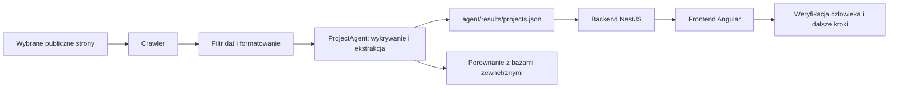

# Radar innowacji

> Ukryte innowacje - jak odnalezc pomysly, ktore moga zmieniac swiat?

Radar innowacji to prototyp wspierajacy wczesne wykrywanie, porzadkowanie i wstepna ocene projektow opisywanych w publicznych zrodlach. Powstal w kontekscie wyzwania Podkarpackiego Centrum Innowacji (PCI), ktore laczy swiat nauki, biznesu i administracji oraz wspiera rozwoj innowacji w regionie. Wyzwanie zwraca uwage na rozwiazania tworzone w szkolach, uczelniach, samorzadach i innych instytucjach publicznych, ktore czesto pozostaja znane tylko lokalnie.

PCI wspiera merytorycznie i finansowo projekty badawczo-rozwojowe uczelni i firm, prowadzi programy akceleracyjne oraz udostepnia laboratoria i narzedzia do prototypowania. Wskazywane obszary obejmuja m.in. motoryzacje, jakosc zycia, ICT, lotnictwo i sektor kosmiczny; infrastruktura wspiera mlodych innowatorow w wieku 16-30 lat.

Prototyp ma pokazac droge od publicznego opisu projektu do katalogu, wstepnej oceny, porownania z innymi rozwiazaniami i wskazania nastepnych krokow. Innowacja moze byc technologiczna, edukacyjna, organizacyjna, spoleczna lub procesowa. To niezalezny prototyp konkursowy, a nie oficjalny system PCI.

## Co dziala

- Agent Python pobiera strony z listy zrodel, filtruje artykuly wedlug daty i wykrywa potencjalne projekty.
- Agent porzadkuje dostepne informacje: nazwe, opis, instytucje, tworcow, cytaty, adres zrodla, tagi i slowa kluczowe.
- Projekt otrzymuje wstepna ocene w trzech wymiarach: potencjal wdrozeniowy (45%), innowacyjnosc i unikalnosc (35%) oraz wykonalnosc i dojrzalosc (20%). Ocena moze zawierac cytaty, wskazac braki i zaproponowac dalsze kroki.
- Agent porownuje wykryte projekty z wybranymi zrodlami zewnetrznymi. Backend dodatkowo wskazuje heurystycznie podobne rekordy z katalogu.
- Backend udostepnia katalog, szczegoly, tekstowe wyszukiwanie i opcjonalna analize AI. Frontend pokazuje katalog pod `/innovations`, szczegoly pod `/innovations/:id` i wyszukiwarke pod `/search`.

Wyszukiwanie w aplikacji obejmuje rekordy, ktore agent juz zapisal. Nie jest to wyszukiwarka calego internetu ani formularz zglaszania pomyslow.

## Jak przeplywaja dane



Szczegolowy pipeline uruchamia sie w katalogu `agent`. Agent domyslnie analizuje artykuly z rozpoznana data publikacji z ostatnich 7 dni; zakres mozna zmienic przez `ARTICLE_MAX_AGE_DAYS`. Lista punktow startowych znajduje sie w [agent/data/sites.csv](agent/data/sites.csv). Obecna lista obejmuje wybrane witryny z calej Polski, nie tylko wojewodztwo podkarpackie.

Backend czyta `agent/results/projects.json` przy kazdym zadaniu. Plik moze zostac zastapiony przez `PROJECTS_FILE`. Identyfikator rekordu jest wyliczany z jego UUID lub tresci; zmiana tresci rekordu bez UUID moze zmienic adres szczegolow.

## Ocena i porownania

Ocena potencjalu jest ostrozna i heurystyczna. Rozpoznaje wybrane fakty z tekstu i podaje wynik oraz pokrycie rozpoznanych kryteriow. Prawdopodobienstwo klasyfikatora `ProjectAgent` dotyczy wykrycia projektu w artykule, a nie jego wartosci ani szans wdrozenia. Oba wyniki wymagaja weryfikacji zrodel i ekspertow.

Porownanie zewnetrzne moze korzystac z:

| Zrodlo | Stan |
| --- | --- |
| Crossref | Publiczne metadane publikacji |
| Interreg | Katalog projektow pobierany z serwisu Interreg Polska |
| EPO OPS | Wymaga `EPO_OPS_KEY` i `EPO_OPS_SECRET` |
| PBN | Wymaga `PBN_APP_ID` i `PBN_APP_TOKEN` |
| UPRP, PPM, biblioteki PAN i BazTOL, NCBiR | Nie sa bezposrednio przeszukiwane przez obecny pipeline |

Brak znalezionego podobienstwa nie potwierdza nowosci. Porownania tekstowe nie zastepuja badania stanu techniki, analizy zastrzezen patentowych ani ustalenia, czy dwa wpisy opisuja ten sam projekt. Zapytania do zrodel zewnetrznych moga przekazywac fragmenty tytulu i opisu.

## Dane referencyjne i walidacja

`agent/data/projects_example.json` zawiera datowane zestawienie referencyjne z 22 listopada 2026 r.: 33 wpisy, z czego 23 oznaczono jako zgodne z kryteriami PCI, a 10 jako niezgodne lub do odrzucenia. Plik jest wykorzystywany przy budowie przykladow treningowych. Nie jest to liczba rekordow w aktywnym katalogu API ani niezalezny test skutecznosci modelu.

Zbior treningowy laczy przyklady syntetyczne, opisy znanych projektow i recznie oznaczone negatywne wyniki crawlera. Trening dobiera progi na wydzielonych domenach, ale ten wynik nie jest niezaleznym pomiarem skutecznosci na nowych, rzeczywistych danych. Do wiarygodnej oceny potrzebny jest wiekszy, recznie oznaczony zbior testowy.

Backend testuje kontrakt API, wyszukiwanie, podobienstwa i ograniczenia zapytan. Frontend jest budowany przez Angular CLI. Testy automatyczne nie dowodza poprawnosci ekstrakcji ani trafnosci rekomendacji na rzeczywistych przypadkach.

### Scenariusz demonstracyjny

1. Wyszukaj projekt w `/search` albo otworz katalog `/innovations`.
2. Przejdz do szczegolow i sprawdz opis, autorow, instytucje, cytaty oraz zrodlo.
3. Omow ocene, jej pokrycie, brakujace informacje i uzasadnienia poszczegolnych kryteriow.
4. Pokaz wewnetrzne podobienstwa i wyniki porownania zewnetrznego, podkreslajac ich ograniczenia.
5. Zakoncz proponowanym nastepnym krokiem i warunkiem jego weryfikacji.

Demonstracje nalezy przeprowadzic na co najmniej dwoch rekordach z aktualnego `agent/results/projects.json`. Zestaw `projects_example.json` moze dostarczyc przykladow referencyjnych, ale nie jest automatycznie katalogiem serwowanym przez API.

### Mierniki do walidacji

Model nie ma jeszcze niezaleznych wynikow skutecznosci na rzeczywistym, oznaczonym zbiorze. W pilocie warto mierzyc precision i recall wykrywania, odsetek rekordow z wystarczajacymi dowodami do oceny, zgodnosc ocen ekspertow oraz trafnosc pierwszych wynikow podobienstwa. Czas od wykrycia projektu do decyzji o dalszym kroku moze mierzyc sprawnosc procesu. Te mierniki wymagaja zebrania i oznaczenia przypadkow; obecne testy automatyczne ich nie zastapily.

## Ograniczenia i dalszy rozwoj

- Nie ma formularza zglaszania innowacji, edycji rekordow, kont uzytkownikow ani zapisu przez API.
- API potrzeb organizacji zwraca pusta liste. Nie ma wiarygodnego dopasowania projektu do konkretnego odbiorcy, partnera ani inwestora.
- Podobienstwo w katalogu jest heurystyka oparta na wspolnych obszarach, slowach kluczowych i terminach tytulu. Nie potwierdza duplikatu ani relacji partnerskiej.
- Dane sa przechowywane jako wynikowy plik JSON, bez wielodostepowej bazy danych. Nie jest to gotowy system produkcyjny dla wielu organizacji.
- Endpoint AI jest opcjonalny, moze generowac koszty, ma limit w pamieci pojedynczego procesu i nie ma uwierzytelniania. Przed publicznym wdrozeniem wymagane sa m.in. uwierzytelnianie, wspoldzielone limity, polityka danych i bezpieczna konfiguracja hostingu.

Najwazniejszym kolejnym krokiem jest uzupelnienie katalogu potrzeb instytucji i danych o potencjalnych uzytkownikach, a nastepnie walidacja na oznaczonych przypadkach z kilku typow organizacji. Przy wdrozeniu nalezy zachowac jasne kryteria oceny, wskazac zrodla danych, zapewnic ochrone danych i mozliwosc integracji z systemami instytucji.

## Uruchomienie

Wymagania: Node.js 20 lub nowszy dla backendu, Node.js zgodny z Angular CLI 20 oraz Python opisany w [README agenta](agent/README.md).

Zainstaluj zaleznosci osobno:

```powershell
npm --prefix backend install
npm --prefix frontend install
```

Uruchom backend i frontend w dwoch terminalach z katalogu glownego:

```powershell
npm --prefix backend run start:dev
```

```powershell
npm --prefix frontend start
```

Backend domyslnie dziala na `http://localhost:3000`, frontend na `http://localhost:4200`. Development frontendu laczy sie z backendem przez `http://127.0.0.1:3000`; domyslne `CORS_ORIGINS` backendu dopuszcza lokalne originy na porcie 4200. Produkcyjny frontend uzywa same-origin API i wymaga, aby serwer zwracal `index.html` dla tras Angulara.

Do uruchomienia pipeline'u agenta przejdz do katalogu `agent`. Przed pierwszym uruchomieniem lub po zmianie modelu wytrenuj checkpointy, a nastepnie uruchom crawler:

```powershell
cd agent
& (Join-Path $PWD 'train.bat')
& (Join-Path $PWD 'run.bat')
```

Agent korzysta z sieci, a jego uruchomienie moze nadpisac pliki w `agent/results/`. Wymaga zaleznosci z `agent/requirements.txt` oraz Chromium Playwright; pelna instrukcja i zmienne konfiguracyjne sa w [README agenta](agent/README.md).

## Testy i build

```powershell
npm --prefix backend test
npm --prefix frontend run build
```

Testy agenta uruchom z katalogu `agent`:

```powershell
python -m unittest discover -s tests -p "test_*.py"
```

## Struktura repozytorium

| Sciezka | Rola |
| --- | --- |
| `agent/` | Crawler, formatowanie, wykrywanie projektow, ocena, zrodla porownawcze i trening modeli |
| `backend/` | NestJS API, mapowanie katalogu, wyszukiwanie i analiza AI |
| `frontend/` | Angular SPA: katalog, karta projektu i wyszukiwarka |
| `agent/data/sites.csv` | Punkty startowe crawlera |
| `agent/data/projects_example.json` | Zestaw referencyjny do przygotowania przykladow treningowych |
| `agent/results/` | Wyniki pipeline'u czytane przez backend |

## Kontekst konkursowy

Wyzwanie dotyczy wczesnego odnajdywania rozwiazan tworzonych m.in. w szkolach, uczelniach i samorzadach, ich wstepnej oceny oraz kierowania do dalszego rozwoju, transferu, komercjalizacji lub wdrozenia. Docelowymi uzytkownikami sa przedstawiciele instytucji publicznych oraz podmioty poszukujace rozwiazan.

Kryteria oceny konkursowej: zgodnosc z wyzwaniem, oryginalnosc, uzytecznosc i UX, kompletnosc prototypu oraz potencjal wdrozeniowy i skalowalnosc - po 20% kazde. To osobne kryteria od wewnetrznej, heurystycznej oceny potencjalu innowacji opisanej wyzej.

Zgloszenie formalne wymaga osobnej prezentacji PDF do 10 slajdow oraz filmu do 3 minut udostepnionego pod publicznym linkiem. Ten README opisuje repozytorium i nie zastepuje tych materialow.

Kontakt do wyzwania PCI: Kacper Moczarny, [k.moczarny@pcinn.org](mailto:k.moczarny@pcinn.org).

Szczegoly techniczne: [frontend](frontend/README.md), [backend](backend/README.md), [agent](agent/README.md).

